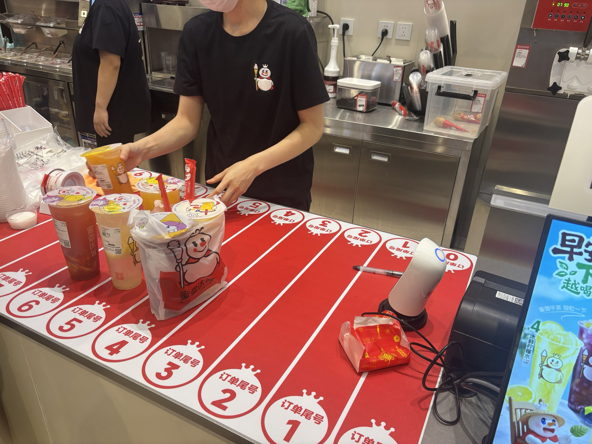

# 论Hashmap与蜜雪冰城



> 面试官：你了解 hashMap 吗，能具体讲讲吗？
>
> 我：那我可太了解了！不就是蜜雪冰城送餐区吗！

> [!NOTE] 灵感来源
> 本文灵感来自于 X 上的一个帖子，[原帖在这里](https://x.com/__soragoto__/status/2114195309970780219)。笔者刷到后觉得很有趣，便借这个例子记录自己对哈希表的理解。本文的展开和解释不一定与原帖相同。

---

## 蜜雪冰城

经常点蜜雪冰城的小伙伴，应该对上图这样的取餐区很熟悉：做好的饮料按号码尾号，被放进不同的区域。取餐时，看一眼自己的尾号，就知道该去哪里找。

为什么要分区？答案似乎很简单：几十杯饮料堆在一起，找起来太麻烦。

但再想一步：**既然是为了方便查找，为什么不按完整号码从小到大排列？这样不是更有序吗？**

或者，为什么偏偏看尾号，而不是开头几位？同一个尾号下仍然会有好几单，这种“只分了一半”的做法，真的够好吗？

有意思的地方就在这里：取餐架不光要让顾客找得快，还要让店员放得快。你觉得更整齐的排列方式，未必能让整个取餐过程更高效。

这个每天都能见到的小设计，其实藏着一种很常见的数据结构：**哈希表（HashMap）。**


## 从取餐区走向哈希表

先比较三种摆放方案：

| 方案 | 查找订单 | 放入新订单 |
| --- | --- | --- |
| 哪里有空放哪里 | 可能需要查看全部订单 | 找到空位即可 |
| 按完整号码排序 | 可以利用大小关系缩小范围 | 需要维护顺序，可能挪动其他订单 |
| 按尾号分区 | 先定位区域，再核对区内订单 | 按同一规则放入对应区域 |

按尾号分区，不必维护全局顺序，就能缩小查找范围。假设架上有 50 单，均匀分进十个区域，每区平均就只有 5 单。

为什么常选尾号？手机号开头可能集中在常见号段，递增订单号的前几位也可能长时间不变；尾号往往更容易分散。当然，实际效果仍取决于号码分布。

> [!TIP] 从生活类比中提取问题
> 接下来真正需要研究的是三个问题：如何把键映射到位置？多个键映射到同一位置怎么办？数据越来越多之后，如何维持效率？取餐架帮我们提出问题，哈希表给出程序里的解决方案。

## 何为哈希表

现在，我们可以把取餐区的设计和哈希表对应起来了。

哈希表通过一个计算规则，把键（Key）映射到某个存储位置，再到那里存取对应的值（Value）。HashMap 则是用哈希表实现键值映射的一种常见数据结构。

在取餐的例子里，可以这样理解：

| 取餐区里的事物 | 哈希表中的概念 |
| --- | --- |
| 用于识别订单的完整号码 | 键（Key） |
| 根据号码决定取餐区域的规则 | 哈希函数及桶索引计算 |
| 编号为 0～9 的取餐区域 | 桶（Bucket） |
| 对应的订单及饮料 | 值（Value） |

如果号码是非负整数，取最后一位的规则可以写成：

```text
桶下标 = 号码 % 10
```

这里的 `%` 表示取余数。例如 `1023 % 10 = 3`，所以订单 1023 放进 3 号桶。

> [!NOTE] 取尾号是一个简化模型
> 真实的 HashMap 还需要处理字符串等不同类型的键，通常会先计算键的哈希值，再根据容量确定桶下标。这里把“计算哈希值”和“定位桶”简化成了取尾号，方便理解。

## 哈希函数：如何决定存储位置？

设表中有 m 个桶，桶下标为 0 到 m−1。定位过程可以拆成两步：

```text
键 key → 哈希值 H(key) → 桶下标 h(key)
```

哈希值通常是一个整数；桶下标则必须落在当前数组的合法范围内。教材中也常把这两步合写为一个哈希函数 h。

### 除留余数法

对非负整数键，一个直观的方法就是取模：

```text
h(key) = key % m
```

取尾号相当于 m = 10。但如果键恰好是 10、20、30、40，它们就全进了 0 号桶。

所以，计算很快并不代表分布一定好。教材中常选适当的素数作模数，以减少某些规律性输入造成的集中；这也不是对任意输入都有效的保证。

### 字符串怎么计算哈希值？

字符串不能直接拿去取模，可以先把字符编码组合成整数。一个教学用的多项式哈希形式是：

```text
H = 0
依次读取每个字符 c：
    H = (H × B + code(c)) % P
最后计算桶下标：
    h = H % m
```

其中 B 是选定的基数，P 是计算哈希值时使用的模数，m 是桶数。把两个模数分开写，是为了区分“生成哈希值”和“压缩到桶下标”。实际实现还需要考虑整数溢出、输入特点和性能。

例如取 B = 31、P = 101，字符编码使用 ASCII：

```text
"ab"：H = (97 × 31 + 98) % 101 = 75
"ba"：H = (98 × 31 + 97) % 101 = 4
```

这比简单地把字符编码相加更能体现顺序，但仍然可能发生冲突。

### 一个合适的哈希函数需要什么？

- **一致性**：在同一套哈希配置下，相等的键必须产生相同的哈希值。
- **分散性**：尽量避免输入中的规律导致大量键聚集。
- **计算成本合理**：定位本身不能太昂贵。

> [!IMPORTANT] 相等的键必须同哈希，反过来不成立
> `a == b` 应当推出 `H(a) == H(b)`；`H(a) == H(b)` 却不能推出 `a == b`。键空间比桶空间大时，不同键映射到同一桶是不可避免的，这也是鸽巢原理的直接体现。
>
> 键存入表后，不应随意修改参与哈希和相等比较的内容，否则后续查找可能从另一个桶开始，找不到原位置中的键。

这里讨论的是用于数据结构的哈希函数，不要求密码学意义上的不可逆性。是否需要抵抗恶意构造的碰撞，则需要根据应用场景另外考虑。

## 冲突处理一：链地址法

细心的读者应该发现了：1023 放在 3 区，2073 也放在 3 区。

两个不同的号码，经过同一条规则，却得到了相同的区域编号。这就是**哈希冲突**。

冲突并不代表订单放错了。顾客到达 3 区后，还需要核对完整号码：

```text
3 区：[1023 的订单] → [2073 的订单] → [3653 的订单]
```

查找 2073 时，先定位 3 区，再依次比较区内号码，就能找到目标。

如果把区内订单想象成用链表串起来的节点，这就接近哈希表解决冲突的一种方法：**链地址法**。每个桶可以容纳多个键值对，定位桶之后，再在桶内查找匹配的键。

> [!IMPORTANT] 同一个桶，不等于同一个键
> 尾号只能帮助我们定位区域，确认订单仍要核对完整标识。HashMap 也需要在桶内比较键，不能仅凭桶下标判断键是否相等。
>
> 这个类比假设完整的订单标识能够区分各笔订单。实际门店中，如果手机号不能唯一识别订单，还需要结合取餐码等信息核对。

## 冲突处理二：开放寻址法

链地址法允许一个桶挂多个元素。另一条路线是：**所有键值对都存放在表内的槽位中，每个槽位至多放一个元素；当前位置被占用，就按规则寻找其他位置。** 这就是开放寻址法。

这里用“槽位”强调数组中的单个位置，避免和前面能容纳一条链表的桶混淆。

关键在于定义一条探测序列 `h(key, i)`，i 从 0 开始。插入与查找必须遵循相同的序列，并设置终止条件，不能无限试探。[NIST 对开放寻址法的定义](https://xlinux.nist.gov/dads/HTML/openAddressing.html)也将线性探测、平方探测和双重哈希列为典型探测方式。

### 线性探测：逐个向后找

```text
h(key, i) = (h₀(key) + i) % m
```

设 m = 11，初始位置为 `h₀(key) = key % 11`，依次插入 22、33、44：

```text
22：0 号槽为空，放入 0
33：0 已占用，放入 1
44：0、1 已占用，放入 2

槽位：  0    1    2    3    4  ...
数据： 22   33   44    空   空  ...
```

查找 44 时，也从 0 开始，依次检查 0、1、2。若在探测途中遇到一个**从未使用过的空槽**，就可以判定目标不存在；若探测完全部 m 个槽仍未找到，也应终止。

线性探测实现简单，访问连续位置也有利于缓存。但连续的占用区域容易越来越长，后来的元素又会加入它们，形成**一次聚集（primary clustering）**。

> [!WARNING] 删除不能直接清空槽位
> 如果删除 33 后把 1 号槽标成“从未使用”，查找 44 就会在这里提前停止，错误地返回不存在。
>
> 常见办法是使用“已删除”标记（墓碑）：查找经过墓碑时继续，插入时可以复用它。实现 Map 的插入或更新时，即使遇到墓碑，也要继续检查后续是否已有相同的键，避免产生重复键。另一种办法是按规则搬移后续元素，修复探测路径。

### 平方探测：按平方偏移查找

平方探测也称二次探测，其一般形式为：

```text
h(key, i) = (h₀(key) + c₁ × i + c₂ × i²) % m
```

取一个简单例子：`c₁ = 0`、`c₂ = 1`。仍然使用 m = 11，从 0 开始探测，前几个位置是：

```text
i：      0  1  2  3  4  5
槽位：   0  1  4  9  5  3
```

依次插入 22、33、44 时，它们会分别放在 0、1、4，而不是挤在连续三个位置。

平方探测可以缓解线性探测中的一次聚集。但初始位置相同的键，仍会沿相同的序列寻找位置，这称为**二次聚集（secondary clustering）**。

> [!CAUTION] 表里有空位，也可能探测不到
> 平方探测能否覆盖足够多的槽位，取决于表长和系数。上面 `i² % 11` 的例子只会访问 0、1、4、9、5、3 这六个不同的位置，继续探测会重复，并不会走遍全表。
>
> 因此需要配套的容量、参数与负载限制。对“奇素数表长 + i² 偏移”这一特定方案，占用元素少于表长一半时，可以保证找到空槽；不能把这个结论套到任意平方探测公式上。

### 双重哈希：让步长也由键决定

```text
h(key, i) = (h₁(key) + i × h₂(key)) % m
```

与固定步长不同，双重哈希用第二个哈希函数决定步长。即使初始位置一样，不同键也可能走出不同的探测路径，减少相同序列带来的聚集。

但步长不能随便选：为了走遍全表，`h₂(key)` 必须与 m 互质。例如 m 为素数时，可以让步长落在 1 到 m−1 之间。有关探测覆盖范围与聚集问题，可参阅 [OpenDSA 的冲突处理章节](https://opendsa-server.cs.vt.edu/ODSA/Books/CS3/html/HashCImproved.html)。

### 两类冲突处理方式如何选择？

| 方面 | 链地址法 | 开放寻址法 |
| --- | --- | --- |
| 冲突元素的位置 | 同一桶关联的链表等结构中 | 表内其他槽位中 |
| 负载因子 | 可以大于 1 | 每槽一个元素时至多为 1，通常提前扩容 |
| 删除 | 从桶内结构中移除 | 需要墓碑或修复探测路径 |
| 空间与访问 | 链表节点通常有指针和分配开销 | 经典实现较紧凑，局部性取决于探测方式 |
| 性能风险 | 少数桶过长 | 高负载、聚集及过多墓碑 |

具体实现还可能有其他优化。理解这些基础方案之后，再看某种语言的 HashMap，会更容易分清通用原理与实现细节。

## 负载因子、扩容与复杂度

先别急着把面试答案写上去，这里还有一个小陷阱。

固定十个区域，n 单平均分进去，每个区域仍然有 n/10 单。如果区内逐个查找，需要检查的订单数量仍会随着 n 增长。

> [!WARNING] 少找一些，不等于 O(1)
> **O(n/10) 在渐进复杂度中仍然是 O(n)。** 固定十个桶，只缩小了查找范围，没有改变查找量随订单数量增长的趋势。
>
> 平均少看很多订单，当然是实实在在的改善。但“查找快了”和“时间复杂度变成 O(1)”是两回事。

那么，为什么通常说 HashMap 的查找平均是 O(1)？

因为它还依赖两个条件：哈希分布足够好，以及桶的数量会根据数据量进行调整，让每个桶里的元素数量保持在较低水平。

这就引出了另一个概念：**负载因子**。

```text
负载因子 = 元素数量 / 桶的数量
```

用符号表示，就是 `α = n / m`。对于链地址法，它表示平均每个桶里的元素数，可以大于 1；对于每槽一个元素的开放寻址法，它表示槽位占用比例。后者接近满表时，寻找空槽会越来越困难，因此通常需要保留一定比例的空槽。

在分布良好、哈希与键比较视为常数成本的条件下，链地址法的期望查找时间为 **O(1 + α)**。要让它保持 O(1)，就需要让 α 有常数上界，而不是永远固定桶数。[Open Data Structures 的哈希表章节](https://opendatastructures.org/newhtml/ods/latex2/hashing.html)给出了相应的分析。

哈希表通常会在负载达到一定阈值时扩容，增加桶数，并按新的索引规则重新分配元素。扩容阈值取决于冲突处理方案和具体实现，并不存在所有哈希表都必须采用的统一数值。开放寻址表还可能需要通过重建来清理墓碑。

继续借用取餐架的例子：如果从 10 个区域增加到 20 个区域，并把规则改成 `号码 % 20`，原先同在 3 区的两单就可能被分开：

```text
1023 % 20 = 3
2073 % 20 = 13
```

> [!IMPORTANT] 摊还 O(1)，不代表每次都一样快
> 扩容本身需要搬动数据，也有成本。在哈希分布良好、采用合理扩容策略等条件下，把扩容成本分摊到一系列插入操作中，插入的期望摊还时间复杂度才是 **O(1)**。某次触发扩容的插入，仍可能需要 O(n) 的时间。

如果哈希分布很差，大量键挤进同一个桶，使用链表的桶内查找最坏仍可能退化为 O(n)。不同实现会采用不同办法缓解这个问题，不能仅凭“用了 HashMap”就认为查找永远一样快。

> [!NOTE] O(1) 的分析也有前提
> 上面的结论把一次哈希计算和键比较视为常数成本。对长度为 L 的字符串，首次计算完整哈希值通常需要 O(L)；比较两个字符串，也可能需要检查多个字符。分析具体程序时，应把键处理成本算进去。

## 都叫“桶”，这和桶排序有什么关系？

到这里，我们一直在说分桶。那按尾号摆饮料，是不是就在做桶排序？

还差一个关键条件：**排序必须得到全局有序的结果。**

尾号为 0 的订单不一定比尾号为 1 的订单小。例如 90 在 0 区，11 在 1 区，如果按区域顺序取出，得到的却是 `90、11`。即使各区域内部排好序，也不能保证区域之间有序。

哈希分桶主要服务于定位，通常不要求桶与桶之间存在大小关系。桶排序则要按数值范围等保序规则分配数据，再在桶内排序，最后依次拼接。这个过程也符合 [NIST 对桶排序的定义](https://xlinux.nist.gov/dads/HTML/bucketsort.html)。

例如，把 0 到 99 的整数分进十个区间桶：

```text
输入：29、14、83、22、17
规则：桶下标 = floor(数值 / 10)

1 号桶 [10, 20)：14、17
2 号桶 [20, 30)：29、22 → 桶内排序 → 22、29
8 号桶 [80, 90)：83

依次拼接：14、17、22、29、83
```

这次，1 号桶里的所有数都小于 2 号桶里的数，2 号桶里的所有数又都小于 8 号桶里的数，所以桶内有序加上按桶顺序拼接，就能得到全局有序。

### 桶排序一定是 O(n) 吗？

也不一定。设有 n 个元素、k 个桶，分配和遍历桶的成本为 O(n + k)，还要加上各桶内部排序的成本。

在经典模型中，如果输入在给定范围内独立、均匀分布，k 与 n 同阶，即使桶内使用插入排序，也能得到期望 O(n) 的总时间。但若所有元素集中到一个桶，使用插入排序就可能退化为 O(n²)。若桶内改用具有 O(s log s) 最坏界的排序算法，最坏总时间也会相应变化，其中 s 是该桶内的元素数。

> [!IMPORTANT] 分桶是一种手段，不是同一个算法
> **哈希表**通过键定位数据；**桶排序**利用桶之间的大小关系组织排序。仅仅“把元素放进不同桶”还不能叫桶排序，更不能由此直接推出 O(n) 的时间复杂度。

如果按个位、十位、百位依次进行稳定分配，并逐轮收集结果，就会进一步涉及**基数排序**。只按尾号分一次区，还没有完成这一过程。

## 再回头看那杯奶茶

现在，取餐架只是整条知识链的起点：从尾号定位，走到哈希函数；从同区多单，走到冲突处理；从订单增加，走到负载因子与扩容。

但生活类比也有边界。取餐架并没有实现完整的 HashMap，分区摆放也不等于桶排序。真正值得带走的是：遇到一个存储与查找问题时，先想清楚如何映射位置、如何区分冲突，以及数据量增长后成本会如何变化。

至于下次面试官问起 HashMap，当然可以从蜜雪冰城讲起——只要最后还能从奶茶店走回数据结构。
